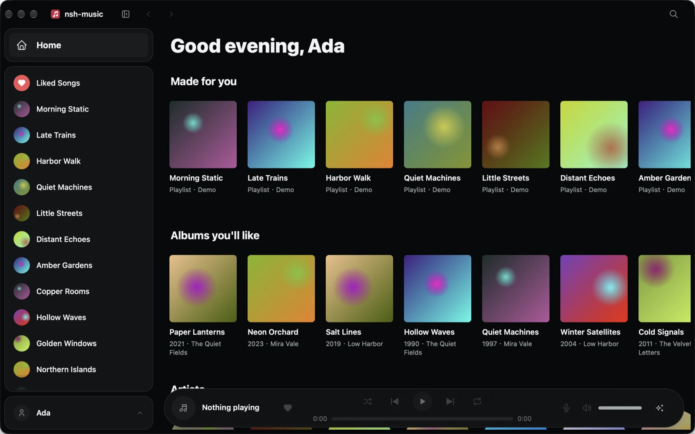

# NSH Music (网易云音乐原生客户端)

**基于 [NSH (Native Shell)](https://nsh.dev) 构建的轻量、纯原生网易云音乐桌面与终端客户端。**



本项目基于 [huacnlee/spotish](https://github.com/huacnlee/spotish) 的原生 UI 架构改造，并参考了 [sogud/mygo-music-netease](https://github.com/sogud/mygo-music-netease) 的网易云协议实现。播放器使用 **Rust 原生网易云 API 协议栈** 和 **`rodio` 音频解码引擎**。

> **非官方客户端声明**：本项目为第三方开源技术实验项目，与网易云音乐（NetEase Cloud Music）无任何关联、背书或赞助关系。所有音乐、封面及商标版权归各自权利人所有。请支持正版音乐与版权方。

---

## 核心特性

- **零外部浏览器依赖**：基于 Rust 直接实现网易云 Web API 与 EAPI（`MD5` + `AES-128-ECB`）通信协议，无需后台运行 Chromium/Edge。
- **纯原生音频解码播放**：内置 `rodio` 音频引擎，直接流式解码播放网易云高品质（`exhigh` MP3 / FLAC）音频流，支持毫秒级进度跳转、音量控制、列表循环、单曲循环与随机播放。
- **免权限 60fps 音频频谱与律动灯效**：在 Rust 音频解码流中直接通过 `MeteredSource` 分流 PCM 音频采样，驱动 16 段 FFT 频谱分析与节拍检测器（`AudioMeter`），无需向操作系统申请系统录音权限即可实现封面色彩律动背景。
- **App 二维码扫码登录**：支持使用网易云音乐手机 App 扫码登录，自动持久化保存会话状态（`netease-session.json`）。
- **完整音乐体验**：
  - **发现音乐**：每日推荐、私人雷达、推荐歌单、官方排行榜
  - **搜索**：支持单曲、歌手、专辑、歌单多维度搜索
  - **个人音乐库**：同步个人创建与收藏的歌单、「我喜欢的音乐」及红心收藏操作
  - **逐行滚动歌词**：自动解析网易云 LRC 时间轴歌词（含桌面端接口回退），支持点击歌词跳转播放

---

## 跨平台支持

| 平台 | 状态 |
| --- | --- |
| macOS, Linux, Windows | 原生窗口界面 + 原生音频解码播放 + 实时频谱律动 |
| Terminal (TUI) | 终端字符界面 + 原生音频解码播放 |
| Web, iOS, Android | 演示模式（内置离线示例数据） |

---

## 工作原理

- **Rust 原生引擎**（`src/music/netease/`）：
  - `crypto.rs`：实现网易云 EAPI 请求的 `AES-128-ECB` 加密与 `MD5` 签名。
  - `client.rs`：负责二维码登录、Cookie 会话持久化、歌单/搜索/专辑/歌手/红心/LRC 歌词请求与音频直链获取。
  - `player.rs`：基于 `rodio` 管理音频输出流与本地播放队列，并在解码时将 PCM 样本实时推送给频谱分析器。
  - `session.rs`：在独立后台线程运行会话与播放状态机，通过 `watch` 通道向 UI 发布状态快照。
- **频谱分析器**（`src/audio.rs`）：对音频采样执行 1024 点 Hann 窗 FFT 变换与低频通量节拍检测，以 60fps 向前端推送律动帧。
- **原生界面**（`App.tsx` 及 `src/pages/`、`src/components/`）：采用 NSH 声明式 TSX 编写，通过各平台原生视图渲染，包含自适应侧边栏、底部悬浮播放栏、全屏 Now Playing 律动视图与虚拟化列表。

代码目录结构的详细说明请参阅 [CONTRIBUTING.md](CONTRIBUTING.md)。

---

## 构建与运行

需要先安装 **Rust** 工具链与 **`nsh` CLI (nightly)**（详见 [CONTRIBUTING.md](CONTRIBUTING.md#环境准备)）：

```sh
# 安装 nsh nightly CLI
curl -fsSL https://nsh.dev/install.sh | sh -s -- --nightly
```

常用命令：

```sh
nsh run                # 编译 Rust 引擎并打包运行桌面客户端
nsh run --target tui   # 在终端（TUI 模式）中运行
NSH_MUSIC_DEMO=1 nsh run # 使用内置离线演示数据运行（无需网络与账号）
nsh check              # 运行 cargo check 与 TypeScript 类型检查
nsh test               # 运行 Rust 单元测试与 TSX 无头端到端测试
nsh build              # 构建并校验原生导出与前端包
```

### 登录账号

首次启动后，无需登录即可浏览推荐歌单、排行榜与搜索音乐。点击右上角或侧边栏的 **Log in** 按钮，会弹出**网易云音乐二维码**，使用网易云音乐手机 App 扫码并确认即可完成登录。登录凭证保存在本地应用数据目录中，重启后自动恢复。

---

## 致谢与开源许可

- 原项目 UI 与架构设计：[huacnlee/spotish](https://github.com/huacnlee/spotish)
- 网易云音乐协议参考：[sogud/mygo-music-netease](https://github.com/sogud/mygo-music-netease)
- 跨平台原生 UI 框架：[NSH (Native Shell)](https://nsh.dev)
- 开源许可证：[Apache-2.0](LICENSE-APACHE)，详见 [NOTICE.md](NOTICE.md)。
